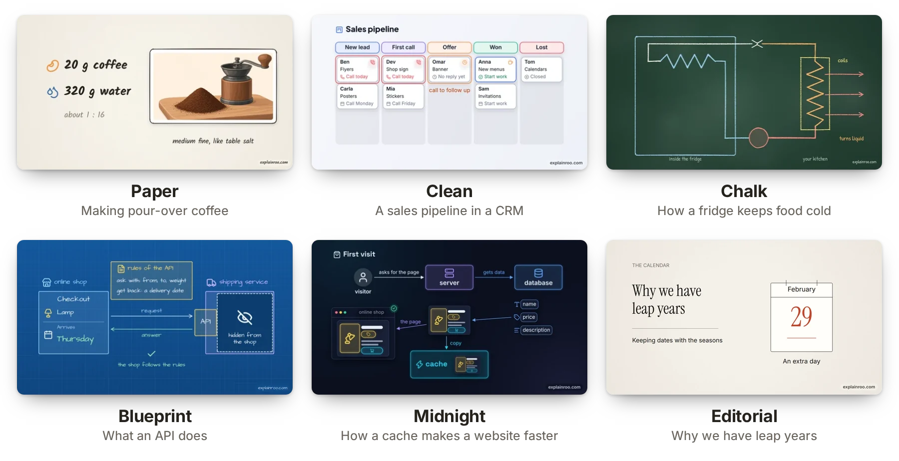

<p align="center">
  <a href="https://www.explainroo.com">
    <picture>
      <source media="(prefers-color-scheme: dark)" srcset="docs/media/logo-dark.png">
      
    </picture>
  </a>
</p>

<p align="center">
  <b>The video studio your AI agent runs.</b><br>
  Free and open source. The voice, the timing and the rendering run on your computer.
</p>

<p align="center">
  <a href="https://www.explainroo.com">Website</a> &nbsp;·&nbsp;
  <a href="https://www.explainroo.com/videos/">Example videos</a> &nbsp;·&nbsp;
  <a href="https://www.explainroo.com/docs/">Docs</a> &nbsp;·&nbsp;
  <a href="AGENTS.md">AGENTS.md</a>
</p>

https://github.com/user-attachments/assets/6dd5dc32-c975-4e0e-8cd4-2ef3ccc11e61

<p align="center">
  <sub>A coding agent made this video with explainroo. You can also watch it on <a href="https://www.explainroo.com/videos/how-explainroo-makes-a-video/">explainroo.com</a>.</sub>
</p>

## News

- **Nov 2026 (draft)**: explainroo 0.5 runs with npx, so you don't have to clone it. It can also use outside services on your own key, like AI video clips and posting to your channels. German narration works with a paid voice or your own recording. A project made before keeps its look, frame for frame, until you add `"defaults": "0.5"` to its `video.json`, which brings the new look, like bigger arrow labels.
- **Oct 20, 2026**: [explainroo 0.4.1](https://www.explainroo.com/news/explainroo-0-4-1/) keeps arrow and chart labels whole while a shot holds.
- **Oct 15, 2026**: [explainroo 0.4](https://www.explainroo.com/news/explainroo-0-4/) films each scene with a camera that follows the narration.
- **Oct 13, 2026**: [explainroo 0.3](https://www.explainroo.com/news/explainroo-0-3/) narrates in Japanese and Mandarin Chinese, and adds the editorial look.
- **Oct 13, 2026**: [explainroo 0.2](https://www.explainroo.com/news/explainroo-0-2/) adds five more languages, other voices and video clips.

All news is on [explainroo.com/news](https://www.explainroo.com/news/).

## Make a video

> [!TIP]
> **Tell your coding agent to use explainroo, and what the video should explain.**
> It works with Claude Code, Codex, Pi and other coding agents. Right now it
> works best with Claude Code and Opus 5.5.

Copy this into your agent and put your topic in place of the brackets:

```text
Make me a short explainer video about [your topic].
Use explainroo for it: run npx --yes explainroo docs and follow what it prints.
```

The agent sets up explainroo, makes the video and checks it. You get an MP4
file.

## How does it work?

An explainer video is a short video where a voice explains a topic and
drawings appear while it speaks. For explainroo, the agent writes two files.
`script.md` has the words the voice says. `scenes.js` draws the pictures with
a bit of JavaScript, and each drawing can appear on a word from the script.
explainroo does the rest:

- **Voice.** [Kokoro](https://huggingface.co/hexgrad/Kokoro-82M), an open
  voice model, reads the script aloud in English, Spanish, French, Italian,
  Brazilian Portuguese, Hindi, Japanese or Mandarin Chinese. It has 54 voices
  and needs no account or API key. You can also use an
  [ElevenLabs](https://elevenlabs.io) or [Cartesia](https://cartesia.ai) voice,
  or record the narration yourself. German works with one of these, because
  Kokoro has no German voice. One project can make the same video in several
  languages, with a script for each.
- **Timing.** [Whisper](https://github.com/openai/whisper) listens to the
  narration and notes when each word is spoken.
- **Pictures.** Chrome runs in the background and draws the frames. The lines
  can look hand drawn ([Rough.js](https://roughjs.com)), and there are 1,800
  icons from [Lucide](https://lucide.dev). A scene can also show charts, math
  formulas, code that changes step by step, your own screenshots and video
  clips such as screen recordings.
- **Camera.** A camera films each scene. It moves in on what the voice talks
  about when there is time, and pulls back at the end so the last frame shows
  the whole idea. Cards and labels are never cut in half while a shot holds.
  Things arrive with a little spring, and the final video has motion blur,
  like a film camera.
- **Sound.** explainroo makes its own background music for each video and
  adds small sound effects. The music gets quieter while the voice speaks.
- **File.** ffmpeg puts it all together into an MP4, with subtitle files,
  YouTube chapters and a cover image.

An agent can't watch a video, so explainroo gives it other ways to check its
work. It saves stills of the scenes and a sheet of small frames for the whole
video. A layout check finds text that is cut off or overlaps, and a speech
check finds words the voice got wrong. For a feed-sized player,
`explainroo check videos/<name> --view-width 854` also flags small text.

## What leaves your computer

Making a video needs no account and no key, and it costs nothing. The voice,
the timing, the music and the rendering run on your computer. Your coding agent
is a separate service with its own terms and prices.

Some commands send something to an outside service, and only when you or your
agent run them:

| You run | What leaves your computer | Where it goes |
| --- | --- | --- |
| `connect` | A test request with your key, or the code from your sign-in | That service |
| `voice` with ElevenLabs or Cartesia | The narration text | That company |
| `voices --provider elevenlabs` or `cartesia` | Your key, to list its voices | That company |
| `image` or `clip` | The prompt and any reference images | OpenRouter and the model's provider |
| `clip --dry-run` | A request for the list of video models and their prices, without your prompt or a key | OpenRouter |
| `services`, when it lists clips | The same request as `clip --dry-run`, at most once a day. It asks for the list of video models and their prices, without your prompt or a key | OpenRouter |
| `share` | Nothing in this version, because the hosted service is coming. Once it runs, the video file and its title | explainroo.com |
| `publish` | The video or a link to it, its title and its text. With a link, first a request for the size of the file there | YouTube, Buffer or Blotato, and whatever they send it to. The size request goes to the host of the link |
| `publish --dry-run` | Your login, to read your channels or accounts, and the same size request | YouTube, Buffer or Blotato, and the host of the link |
| `capture` | Requests for the page you name and the files it loads | That site and the servers it loads from |

With ElevenLabs or Cartesia, the commands that make missing narration, like
`check` and `render`, send the narration text too.

The first run downloads the voice and speech models from Hugging Face. Other
languages need one more speech model, which downloads the first time, and
Japanese and Chinese also download their fonts from GitHub. On Debian and
Ubuntu, `doctor --fetch` downloads espeak-ng's packages from the computer's own
package sources when a language needs it. Nothing of yours goes along with
these downloads. explainroo has no telemetry, so it sends
nothing about how you use it.

Nothing uploads to the hosted service without the explicit `explainroo share`
command. In this version `share` sends nothing at all, because the service
doesn't run yet.

## Looks

There are six looks: paper, clean, chalk, blueprint, midnight and editorial.
You change a video's look with one setting in `video.json`. A project can also
bring its own look, a small JSON file with its colors, fonts and background.
Here is one frame in each built-in look, from the example videos.

<p align="center">
  <picture>
    <source media="(prefers-color-scheme: dark)" srcset="docs/media/looks-dark.webp">
    
  </picture>
</p>

## Sizes

You pick the size for the place the video goes. YouTube videos are wide, and
Shorts, TikTok and Reels are tall. Instagram and LinkedIn posts use 4:5, and
there is a square size too. Shorts, TikTok and Reels put their own buttons
over the video, and explainroo keeps your text out of those spots.

<p align="center">
  <picture>
    <source media="(prefers-color-scheme: dark)" srcset="docs/media/sizes-dark.webp">
    
  </picture>
</p>

Tall, 4:5 and square videos get captions that light up word by word.
`"captions": "bold"` shows two to four big words at a time instead, with
numbers and marked words in color. For Shorts, TikTok and Reels, `s.short`
draws the parts short videos often have, like a hook title that is there on the
first frame (`explainroo docs short-video`). One project can render several
sizes: `explainroo render videos/demo --size tiktok` writes the TikTok version
next to the wide one. `"sizes"` in `video.json` gives one size settings of its
own, like bold captions and a quicker pace for TikTok only.

## More than an MP4

Every render also writes subtitle files (`.srt` and `.vtt`) that YouTube and
LinkedIn accept, a cover image for the thumbnail, and YouTube chapters when
the script names them. `--format gif` makes a GIF for a README or a post.
`--transparent --format mov` makes a video with a transparent background, for
putting a diagram over camera footage in a video editor. `explainroo export`
writes a small web player that draws the video sharp at any size and embeds
with an iframe.

## Pace

`"pace": 1.2` in a video's `video.json` makes the voice, the pauses and the
animations 20% quicker. The music gets a little quicker too. Pace goes from
0.7 to 1.6, and 1 is normal.

## Product demos

explainroo can also make product demos, the videos software companies make to
show their app. The agent rebuilds the app's screens from its code or its
website, with the same colors, fonts and button labels. A mouse pointer then
clicks through the screens and types into the fields. Tell your agent which
product it is and where to find its code or website. `explainroo capture`
saves the live site's screenshots, colors, font files, logo and wording first,
with the page's text and a list of its images. A real screen recording can
play inside a scene too.

<p align="center">
  <a href="https://www.explainroo.com/videos/unspar-product-demo/">
    
  </a>
</p>

Here are the demos for [Unspar](https://www.explainroo.com/videos/unspar-product-demo/)
and [Vroni](https://www.explainroo.com/videos/vroni-product-demo/), two of my
own products. The files for the Unspar demo are in
[examples/unspar-demo](examples/unspar-demo). explainroo.com also has
unofficial demos of [Gmail, ChatGPT and Claude](https://www.explainroo.com/videos/#product-demos).

## Outside services

Each step of making a video has a free choice first. The services that cost
money use your own account and key:

| Step | Free | Costs money |
| --- | --- | --- |
| Voice | Kokoro, or your own recording | ElevenLabs, Cartesia |
| Timing | Whisper | |
| Images | The built-in icons and your own files | OpenRouter |
| Clips | Your own footage | OpenRouter |
| Music | The built-in music, your own file, or Soundroo | |
| Sharing | A web player for your own site, or a link from `share` (coming) | |
| Posting | A package you upload yourself, YouTube, or Buffer on its free plan | Blotato |

`explainroo services` lists every choice with what it costs and what data
leaves your computer. For clips it also shows today's price per second.
`explainroo connect <service>` sets one up and tests your key or login. One
OpenRouter key makes images and clips. explainroo's instructions tell your
agent to show you the options, free ones first, and to let you choose.

A project keeps a record of what was paid for in its `history/` folder. The
same request again uses the file it already bought. After a crash, a clip that
was already ordered is picked up again, and a request whose outcome is unknown
is never sent again by itself. `explainroo history` shows the record, and
`explainroo docs connectors` says how to add a service.

## AI video clips

`explainroo clip` buys a short video clip that an AI model makes from a text
prompt. It goes through OpenRouter on your own key, and the clip plays in a
scene like any other video file. `--dry-run` shows the price and spends
nothing, also before you have a project, and it lists the lengths the model
takes. A paid run needs `--max-cost` or a budget. Before it buys, `clip` checks
the price against that cap and stops when the price is higher. The final cost
is known only after the job, and it can come out a little higher than the
price. `"clipBudget": 0.40` in `video.json`, or `--budget 0.40`, is one
budget for all clips of a video. With it `--max-cost` is optional, and `clip`
stops before a clip that would go over it. Clips work for short shots of the real world,
like a street or food. They get text and diagrams wrong, and a character looks
different in each clip.
`explainroo docs clips` has the details.

## Music and sound files

A video can play your own music file instead of the built-in music. explainroo
brings it to the level of the built-in music and lowers it while the voice
speaks. `s.sound` plays a sound file on a word. [Soundroo](https://www.soundroo.com)
is a free tool where your agent writes original music, and it renders the
track on your computer. `explainroo docs music` has the details.

## Posting a video

`explainroo package` writes a folder with everything needed to post a video on
one platform: YouTube, Shorts, TikTok, Reels, LinkedIn or X. Next to the video
at the right size, it holds the words for the post. It also says whether to mark
the post as made with AI, and why. You can upload the folder yourself.

`explainroo share` uploads a finished video to explainroo.com and gives back a
page link. That hosted service is coming. Until it runs, `share` sends nothing,
says so and makes no link.

`explainroo publish` posts a package through YouTube, Buffer or Blotato, with
your own account. `--dry-run` shows the exact post first, and a real run posts
only after a yes. `explainroo docs publishing` has the details.

## Partners

Partners are coming. A partner will be a company that pays to be built in as
one of the choices for a step. There are none yet. `explainroo services`
always labels a partner as a "paid partner", and the free choices stay first
in every step. explainroo's instructions tell your agent never to pick a paid
service for you.

## Install it yourself

```bash
npx --yes explainroo doctor --fetch
```

This checks your computer and downloads the voice and timing models once,
about 400 MB together. You don't have to clone anything. You need Node.js
20.11 or newer, ffmpeg, and Chrome or Chromium. You don't need a graphics
card. I develop explainroo on Linux, and its tests run on Linux, macOS and
Windows for every change.

For narration with Kokoro, the free voice, in Spanish, French, Italian,
Portuguese or Hindi, also install
[espeak-ng](https://github.com/espeak-ng/espeak-ng), for example with
`sudo apt install espeak-ng` or `brew install espeak-ng`.
`npx --yes explainroo doctor --language es` checks what Spanish needs. On Debian
and Ubuntu without root, `npx --yes explainroo doctor --fetch --language es`
puts a copy of espeak-ng in explainroo's cache folder instead. Japanese and
Chinese need Python with [misaki](https://github.com/hexgrad/misaki) instead,
as described in [docs/japanese-and-chinese.md](docs/japanese-and-chinese.md).
German narration needs neither, and it works with ElevenLabs, Cartesia or your
own recording, as [docs/languages.md](docs/languages.md) describes.

Then ask your agent for a video in any folder, for example "Make a 60 second
video about how HTTPS keeps a password secret. Use explainroo: run
npx --yes explainroo docs and follow what it prints." The agent saves the
video in its project folder as `out/video.mp4`. The example videos are in
[examples/](examples/), and their sources come with the package too, in the
folder that `explainroo doctor` prints. The full documentation is on
[explainroo.com](https://www.explainroo.com/docs/).

Your agent can also keep explainroo as a plugin or skill, so it knows the tool
without being told:

- Claude Code: `/plugin marketplace add vincentsch/explainroo`, then
  `/plugin install explainroo@explainroo`
- Codex: `codex plugin marketplace add vincentsch/explainroo`, then
  `codex plugin add explainroo@explainroo`
- skills.sh: `npx skills add vincentsch/explainroo`

To change the code, clone it instead:

```bash
git clone https://github.com/vincentsch/explainroo.git
cd explainroo
npm install
node bin/explainroo.js doctor --fetch
```

## The watermark

Each video has a small "explainroo.com" in one corner. `"watermark": false` in
`video.json` turns it off. Please keep it if you can, because that is how
other people find explainroo. A TikTok package has no watermark, because
TikTok's rules don't allow apps to add one. The
[publishing page](docs/publishing.md#why-the-tiktok-file-has-no-watermark)
quotes them.

## Credits and license

explainroo is MIT licensed. The voice comes from
[Kokoro](https://huggingface.co/hexgrad/Kokoro-82M), and the word timing from
[Whisper](https://github.com/openai/whisper) through
[Transformers.js](https://github.com/huggingface/transformers.js). The
drawings use [Rough.js](https://roughjs.com) and [Lucide](https://lucide.dev)
icons. [MathJax](https://www.mathjax.org) typesets the formulas.
[Playwright](https://playwright.dev) runs Chrome, and
[ffmpeg](https://ffmpeg.org) makes the video file. For other languages,
explainroo runs [espeak-ng](https://github.com/espeak-ng/espeak-ng) as a
separate program, with phoneme rules from Kokoro's
[misaki](https://github.com/hexgrad/misaki), and misaki itself for Japanese
and Chinese. [OpenCC](https://github.com/nk2028/opencc-js) and
[pinyin-pro](https://github.com/zh-lx/pinyin-pro) help the speech check
compare Chinese, and [HarfBuzz](https://github.com/harfbuzz/harfbuzzjs) keeps
web player fonts small. The fonts, including Noto Sans CJK for Japanese and
Chinese, are under the SIL Open Font License.
