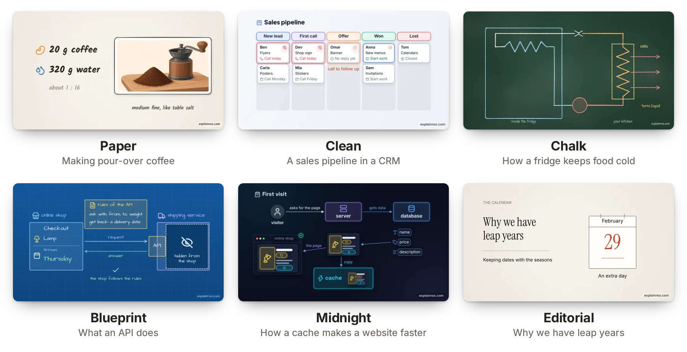

<p align="center">
  <a href="https://www.explainroo.com">
    <picture>
      <source media="(prefers-color-scheme: dark)" srcset="docs/media/logo-dark.png">
      
    </picture>
  </a>
</p>

<p align="center">
  <b>Explainer videos made by your AI agent.</b><br>
  Free and open source. The voice, the timing and the rendering run on your computer.
</p>

<p align="center">
  <a href="https://www.explainroo.com">Website</a> &nbsp;·&nbsp;
  <a href="https://www.explainroo.com/videos/">Example videos</a> &nbsp;·&nbsp;
  <a href="https://www.explainroo.com/docs/">Docs</a> &nbsp;·&nbsp;
  <a href="AGENTS.md">AGENTS.md</a>
</p>

https://github.com/user-attachments/assets/6dd5dc32-c975-4e0e-8cd4-2ef3ccc11e61

<p align="center">
  <sub>A coding agent made this video with explainroo. You can also watch it on <a href="https://www.explainroo.com/videos/how-explainroo-makes-a-video/">explainroo.com</a>.</sub>
</p>

## News

- **Oct 13, 2026**: [explainroo 0.3](https://www.explainroo.com/news/explainroo-0-3/) narrates in Japanese and Mandarin Chinese, and adds the editorial look.
- **Oct 13, 2026**: [explainroo 0.2](https://www.explainroo.com/news/explainroo-0-2/) adds five more languages, other voices and video clips.
- **Oct 4, 2026**: [A check for small video players](https://www.explainroo.com/news/small-player-check/) warns when text gets too small in a feed.

All news is on [explainroo.com/news](https://www.explainroo.com/news/).

## Make a video

> [!TIP]
> **Give your coding agent this repo and tell it what the video should explain.**
> It works with Claude Code, Codex, Pi and other coding agents. Right now it
> works best with Claude Code and Opus 5.5.

Copy this into your agent and put your topic in place of the brackets:

```text
Make me a short explainer video about [your topic].
Use explainroo for it: clone https://github.com/vincentsch/explainroo,
read its AGENTS.md and follow the steps.
```

The agent sets up explainroo, makes the video and checks it. You get an MP4
file.

## How does it work?

An explainer video is a short video where a voice explains a topic and
drawings appear while it speaks. For explainroo, the agent writes two files.
`script.md` has the words the voice says. `scenes.js` draws the pictures with
a bit of JavaScript, and each drawing can appear on a word from the script.
explainroo does the rest:

- **Voice.** [Kokoro](https://huggingface.co/hexgrad/Kokoro-82M), an open
  voice model, reads the script aloud in English, Spanish, French, Italian,
  Brazilian Portuguese, Hindi, Japanese or Mandarin Chinese. It has 54 voices
  and needs no account or API key. You can also use an [ElevenLabs](https://elevenlabs.io) voice or
  record the narration yourself.
- **Timing.** [Whisper](https://github.com/openai/whisper) listens to the
  narration and notes when each word is spoken.
- **Pictures.** Chrome runs in the background and draws the frames. The lines
  can look hand drawn ([Rough.js](https://roughjs.com)), and there are 1,800
  icons from [Lucide](https://lucide.dev). A scene can also show charts, math
  formulas, code that changes step by step, your own screenshots and video
  clips such as screen recordings.
- **Camera.** A camera films each scene. It moves in on what the voice talks
  about when there is time, and pulls back at the end so the last frame shows
  the whole idea. Cards and labels are never cut in half while a shot holds.
  Things arrive with a little spring, and the final video has motion blur,
  like a film camera.
- **Sound.** explainroo makes its own background music for each video and
  adds small sound effects. The music gets quieter while the voice speaks.
- **File.** ffmpeg puts it all together into an MP4, with subtitle files,
  YouTube chapters and a cover image.

An agent can't watch a video, so explainroo gives it other ways to check its
work. It saves stills of the scenes and a sheet of small frames for the whole
video. A layout check finds text that is cut off or overlaps, and a speech
check finds words the voice got wrong. For a feed-sized player,
`explainroo check videos/<name> --view-width 854` also flags small text.

None of this leaves your computer, and it costs nothing. Your coding agent is
a separate service with its own terms and prices. If you want, the agent can
also make illustrations with an AI image model through OpenRouter, and you pay
for each image.

## Looks

There are six looks: paper, clean, chalk, blueprint, midnight and editorial.
You change a video's look with one setting in `video.json`. A project can also
bring its own look, a small JSON file with its colors, fonts and background.
Here is one frame in each built-in look, from the example videos.

<p align="center">
  <picture>
    <source media="(prefers-color-scheme: dark)" srcset="docs/media/looks-dark.webp">
    
  </picture>
</p>

## Sizes

You pick the size for the place the video goes. YouTube videos are wide, and
Shorts, TikTok and Reels are tall. Instagram and LinkedIn posts use 4:5, and
there is a square size too. Shorts, TikTok and Reels put their own buttons
over the video, and explainroo keeps your text out of those spots.

<p align="center">
  <picture>
    <source media="(prefers-color-scheme: dark)" srcset="docs/media/sizes-dark.webp">
    
  </picture>
</p>

Tall, 4:5 and square videos get captions that light up word by word. One
project can render several sizes: `explainroo render videos/demo --size tiktok`
writes the TikTok version next to the wide one.

## More than an MP4

Every render also writes subtitle files (`.srt` and `.vtt`) that YouTube and
LinkedIn accept, a cover image for the thumbnail, and YouTube chapters when
the script names them. `--format gif` makes a GIF for a README or a post.
`--transparent --format mov` makes a video with a transparent background, for
putting a diagram over camera footage in a video editor. `explainroo export`
writes a small web player that draws the video sharp at any size and embeds
with an iframe.

## Pace

`"pace": 1.2` in a video's `video.json` makes the voice, the pauses and the
animations 20% quicker. The music gets a little quicker too. Pace goes from
0.7 to 1.6, and 1 is normal.

## Product demos

explainroo can also make product demos, the videos software companies make to
show their app. The agent rebuilds the app's screens from its code or its
website, with the same colors, fonts and button labels. A mouse pointer then
clicks through the screens and types into the fields. Tell your agent which
product it is and where to find its code or website. `explainroo capture`
saves the live site's screenshots, colors, fonts, logo and wording first, and
a real screen recording can play inside a scene too.

<p align="center">
  <a href="https://www.explainroo.com/videos/unspar-product-demo/">
    
  </a>
</p>

Here are the demos for [Unspar](https://www.explainroo.com/videos/unspar-product-demo/)
and [Vroni](https://www.explainroo.com/videos/vroni-product-demo/), two of my
own products. The files for the Unspar demo are in
[examples/unspar-demo](examples/unspar-demo). explainroo.com also has
unofficial demos of [Gmail, ChatGPT and Claude](https://www.explainroo.com/videos/#product-demos).

## Install it yourself

You need Node.js 20.11 or newer, ffmpeg, and Chrome or Chromium. The first
setup downloads the voice and timing models once, about 400 MB together. You
don't need a graphics card. I develop explainroo on Linux, and its tests run
on Linux, macOS and Windows for every change.

```bash
git clone https://github.com/vincentsch/explainroo.git
cd explainroo
npm install
node bin/explainroo.js doctor --fetch
```

For narration in Spanish, French, Italian, Portuguese or Hindi, also install
[espeak-ng](https://github.com/espeak-ng/espeak-ng), for example with
`sudo apt install espeak-ng` or `brew install espeak-ng`. Japanese and
Chinese need Python with [misaki](https://github.com/hexgrad/misaki) instead,
as described in [AGENTS.md](AGENTS.md#japanese-and-chinese).

Then start your agent in the `explainroo` folder and ask for a video, for
example "Make a 60 second video about how HTTPS keeps a password secret." The
agent follows [AGENTS.md](AGENTS.md) and saves the video as
`videos/<name>/out/video.mp4`. The example videos are in
[examples/](examples/), and the full documentation is on
[explainroo.com](https://www.explainroo.com/docs/).

## The watermark

Each video has a small "explainroo.com" in one corner. `"watermark": false` in
`video.json` turns it off. Please keep it if you can, because that is how
other people find explainroo.

## Credits and license

explainroo is MIT licensed. The voice comes from
[Kokoro](https://huggingface.co/hexgrad/Kokoro-82M), and the word timing from
[Whisper](https://github.com/openai/whisper) through
[Transformers.js](https://github.com/huggingface/transformers.js). The
drawings use [Rough.js](https://roughjs.com) and [Lucide](https://lucide.dev)
icons. [MathJax](https://www.mathjax.org) typesets the formulas.
[Playwright](https://playwright.dev) runs Chrome, and
[ffmpeg](https://ffmpeg.org) makes the video file. For other languages,
explainroo runs [espeak-ng](https://github.com/espeak-ng/espeak-ng) as a
separate program, with phoneme rules from Kokoro's
[misaki](https://github.com/hexgrad/misaki), and misaki itself for Japanese
and Chinese. [OpenCC](https://github.com/nk2028/opencc-js) and
[pinyin-pro](https://github.com/zh-lx/pinyin-pro) help the speech check
compare Chinese, and [HarfBuzz](https://github.com/harfbuzz/harfbuzzjs) keeps
web player fonts small. The fonts, including Noto Sans CJK for Japanese and
Chinese, are under the SIL Open Font License.
